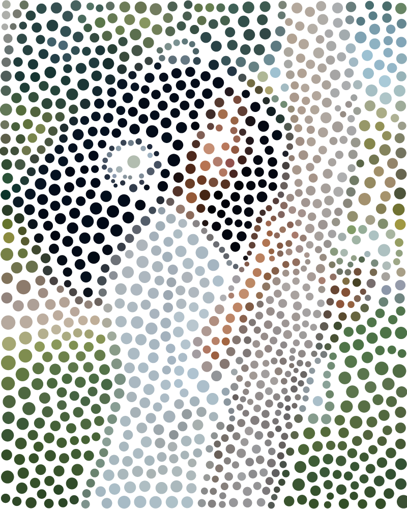

# pointimg

[](https://github.com/pvtc/pointimg/releases)
[](LICENSE)
[](https://www.rust-lang.org)
[](https://www.rust-lang.org)

Filtre pointilliste qui transforme une image en une composition de points colorés de tailles variables. Chaque point prend la couleur moyenne de sa zone et son rayon est modulé par la luminance et la variance locale.

## Fonctionnalités

- **4 algorithmes** : Grille, K-means, Voronoi (Lloyd pondéré), Quadtree adaptatif
- **4 formes de points** : Cercle, Carré, Ellipse (aspect + rotation), Polygone régulier (3-12 côtés)
- **Density map** : redistribution automatique des points selon le détail local
- **Export PNG et SVG** vectoriel
- **Deux interfaces interactives** : egui/wgpu (par défaut) et GTK4/libadwaita, avec aperçu progressif et glisser-déposer
- **CLI** avec tous les paramètres accessibles
- **Palette réduite** optionnelle (quantification des couleurs)
- **Fond personnalisable** : blanc, noir, n'importe quelle couleur `#rrggbb`, ou `transparent` (sortie RGBA)
- **Correction gamma** optionnelle : les moyennes sont calculées en espace linéaire ; le chemin CMJN halftone conserve une précision `f32`, tandis que les autres algorithmes restent en RGB8
- **Rendu anti-aliasé** : supersampling 4×4 (pas d'effet escalier)
- **Traitement par lot** : glob/dossier en entrée, pattern par fichier (`{n}`, `{stem}`, `{name}`)
- **Prévisualisation rapide** : sous-échantillonnage source via `--preview WxH`
- **Presets** : charge/sauvegarde les paramètres dans un TOML versionné (les anciens presets plats restent lisibles)
- **Quatre algorithmes de dithering** sur la palette quantifiée : Floyd-Steinberg, Riemersma (queue longue, moins de « vers ») et les trames ordonnées de Bayer 4×4 / 8×8 pour le rendu « pixel art » — `--dithering [MODE]`
- **Angle de trame halftone** : rotation de la grille via `--grid-angle`
- **Rosette CMJN** & **halftone N couleurs dominantes** (`--halftone cmyk|dominant-N`) — mélange soustractif multiply, screening AM (grille rotationée) ou FM (blue noise stochastique)
- **Formats de sortie** : PNG/JPEG/BMP/TIFF/WebP par défaut ; AVIF via `--features avif`
- **Profils colorimétriques** : profils ICC d'entrée détectés automatiquement, sRGB, Display-P3 ou fichiers `.icc` via `--input-profile` et `--output-profile`
- **Density map GPU optionnelle** : compiler avec `--features gpu`, activer avec
  `POINTIMG_GPU=1` ; fallback CPU/SAT automatique
- **Protection des ressources** : dimensions vérifiées avant décodage, maximum 8M de pixels,
  paramètres de complexité bornés et exports écrits atomiquement

## Exemples

| Source                                                                                       | Résultat (Voronoi, 1200 points)                |
| -------------------------------------------------------------------------------------------- | ---------------------------------------------- |
| [`pexels-kofishelbyfotos-38152015.jpg`](assets/examples/pexels-kofishelbyfotos-38152015.jpg) |  |

Images de test : [`kilauea25_0.jpeg`](assets/examples/kilauea25_0.jpeg),
[`pexels-kofishelbyfotos-38152015.jpg`](assets/examples/pexels-kofishelbyfotos-38152015.jpg),
[`pexels-ruyan-ayten-153760-4190725.jpg`](assets/examples/pexels-ruyan-ayten-153760-4190725.jpg).

## Installation

### Binaires pré-compilés

Téléchargez les binaires depuis la page [Releases](https://github.com/pvtc/pointimg/releases) pour votre plateforme :

- Linux (x86_64, ARM64)
- macOS (Intel, Apple Silicon, Universel)
- Windows (x86_64)

### Compilation depuis les sources

```bash
cargo build --release
```

Les binaires sont dans `target/release/` :

- `pointimg` -- outil CLI
- `pointimg-gui` -- application GUI egui/wgpu (nécessite Vulkan ou OpenGL)
- `pointimg-gtk` -- application GUI GTK4/libadwaita (feature optionnelle `gtk`)

Pour compiler uniquement le CLI (sans les dépendances GUI) :

```bash
cargo build --release --no-default-features
```

Pour compiler la GUI GTK4 (nécessite GTK 4.10+ et libadwaita 1.4+) :

```bash
cargo build --release --no-default-features --features gtk --bin pointimg-gtk
```

## Utilisation CLI

```bash
# Voronoi, 1500 points, fond blanc
pointimg -i photo.jpg -o result.png --algorithm voronoi --num-points 1500

# Utiliser un profil ICC d'entrée (détection automatique par défaut)
pointimg -i photo-p3.jpg -o result.png --input-profile display-p3

# Convertir et embarquer un profil ICC de sortie
pointimg -i photo.jpg -o result.png --output-profile display-p3.icc

# Grille, fond noir
pointimg -i photo.jpg -o result.png --algorithm grid --cols 60 --bg black

# Fond hexadécimal personnalisé
pointimg -i photo.jpg -o result.png --bg "#1a1a2e"

# Forme carrée
pointimg -i photo.jpg -o result.png --shape square

# Hexagones
pointimg -i photo.jpg -o result.png --shape polygon --polygon-sides 6

# Export SVG
pointimg -i photo.jpg --svg --algorithm voronoi --num-points 2000

# Fond transparent (sortie RGBA, alpha 0 entre les points)
pointimg -i photo.jpg -o result.png --bg transparent

# Correction gamma (moyennes perceptuelles)
pointimg -i photo.jpg -o result.png --gamma

# Traitement par lot (glob ou dossier) + pattern par fichier
pointimg -i "photos/*.jpg" -o "out/{stem}_{n}.png" --algorithm grid --cols 50

# Prévisualisation rapide (sous-échantillonnage source)
pointimg -i big.jpg -o preview.png --preview 300x300

# Palette + dithering Floyd-Steinberg (--dithering seul)
pointimg -i photo.jpg -o result.png --palette 8 --dithering

# Palette + trame de Bayer (rendu « pixel art »)
pointimg -i photo.jpg -o result.png --palette 2 --dithering bayer8

# Angle de trame halftone (Grille)
pointimg -i photo.jpg -o result.png --algorithm grid --cols 60 --grid-angle 30

# Sauvegarder / rappeler des presets TOML
pointimg --save-preset out.toml --algorithm voronoi --num-points 1500 --gamma
pointimg --preset out.toml -i photo.jpg -o result.png

# WebP par défaut ; AVIF nécessite `cargo build --features avif`
pointimg -i photo.jpg -o result.webp

# Rosette CMJN (vrai mélange soustractif, 4 canaux à 15°/75°/0°/45°)
pointimg -i photo.jpg -o rosette.png --halftone cmyk --halftone-freq 60

# Halftone utilisant les N couleurs dominantes (au lieu de CMJN)
pointimg -i photo.jpg -o dominants.png --halftone dominant-6 --halftone-freq 80

# Screening stochastique FM (blue noise) au lieu d'AM (grille rotationée)
pointimg -i photo.jpg -o stochastic.png --halftone cmyk --screening fm
```

Voir `pointimg --help` pour la liste complète des options.

### Limites de ressources et portée des paramètres

Pour protéger la mémoire, les images sont limitées à 8 388 608 pixels et à
65 535 pixels par côté. Les valeurs invalides ou non finies sont rejetées avant
le traitement : 100 000 points maximum, 50 000 pour K-means/Voronoi, 8 192
colonnes, 100 itérations et une
palette de 2 à 256 couleurs. `num_points`, `iterations`, `variance_sensitivity`
et `max_boost` concernent K-means/Voronoi/Quadtree ; `cols` et `grid-angle`
concernent uniquement Grid. La fréquence et les rayons halftone ne sont utilisés
que par l’algorithme halftone.

Les presets actuels contiennent `preset_version = 1` et une table TOML
`[params]`. Les presets plus anciens, dont les paramètres sont à la racine,
restent compatibles. Une version future inconnue est refusée explicitement afin
de ne pas appliquer des valeurs par défaut potentiellement différentes.

## Utilisation GUI

Les deux interfaces (egui et GTK4) offrent les mêmes capacités :

- **Actions visibles en permanence** : ouvrir, dossier, presets, recalculer,
  annuler/rétablir, exporter, copier — plus rien d'important caché en bas d'un
  panneau à faire défiler.
- **Comparaison avant/après** : mode par défaut, un curseur sépare la source du
  résultat dans la même image (double-clic pour le recentrer).
- **Aperçu rapide** : par défaut, les réglages sont calculés sur une image
  réduite (moitié ou quart), puis la passe en pleine résolution est déclenchée
  dès que vous arrêtez de manipuler les réglages. Le rendu affiché est signalé
  comme « obsolète » tant que la version définitive n'est pas prête, et l'export
  reste bloqué tant qu'il ne l'est pas.
- **Presets intégrés** : une liste de points de départ validés (pointillisme
  classique, stippling fin, aplats graphiques, rosette CMJN, trame FM, moiré,
  mosaïque, pastilles, calques transparents) en plus des fichiers TOML. Chacun
  est illustré par **une vignette rendue avec ses propres réglages** : on choisit
  un preset sur son résultat, pas sur son nom. Les images sont dans
  `assets/presets/`, régénérées par `cargo run --example preset_thumbnails` ;
  sans elles, les deux interfaces retombent sur une simple liste de noms.
- **Quatre algorithms de dithering** pour la palette réduite : Floyd-Steinberg,
  Riemersma (queue longue, moins de « vers ») et les trames ordonnées de
  Bayer 4×4 / 8×8 pour le rendu « pixel art ». Avec deux couleurs, Bayer
  donne un bilevel strict.
- **Taille de l'export mesurée** : la barre d'état annonce le poids réel de
  chaque format (obtenu en encodant le rendu, pas par estimation) et le gain
  par rapport au fichier source — `source 3,8 Mo · PNG −63 %`.
- **Réglages en saisie directe** : chaque valeur est modifiable au clavier, avec
  les plages réelles acceptées par le moteur (jusqu'à 100 000 points, 8 192
  colonnes, 256 couleurs de palette), et doublée d'un curseur pour les plages
  larges (nombre de points, rayons — dont une paire « min / max » réglable d'un
  geste, en échelle logarithmique ou racine selon la plage).
- **Navigation dans un dossier** : ouvrir un dossier puis `←`/`→` pour passer
  d'une image à l'autre.
- **Titre de fenêtre et barre d'état** nommant le fichier, ses dimensions et
  l'état du calcul ; les erreurs passent par des notifications, affichées assez
  longtemps pour être lues au lieu d'être écrasées à la frame suivante.
- **Ouverture depuis la ligne de commande ou le gestionnaire de fichiers** :
  `pointimg-gtk photo.jpg` ouvre cette image, un dossier active la navigation.
  Les entrées de bureau sont dans `packaging/`.
- **Images récentes** : l'interface GTK les lit dans `GtkRecentManager`, la
  liste que montre toute application GNOME ; egui tient la sienne.
- **Panneau de réglages redimensionnable** : il se replie sous 900 px (GTK) et
  revient depuis l'en-tête. Sur egui, les quatre sections se replient
  individuellement et le choix est mémorisé d'un lancement à l'autre.
- **Confort d'interface** (egui) : taille de 85 à 160 % et thème automatique,
  clair ou sombre depuis le panneau de réglages — les deux réglages sont
  mémorisés d'un lancement à l'autre ; sous 640 px, le côte-à-côte s'empile
  automatiquement.

### egui (par défaut)

```bash
pointimg-gui
```

Le panneau de réglages compte quatre sections repliables, et `Ctrl+K` ouvre
une palette de commandes listant chaque action avec son raccourci.

### GTK4 / libadwaita (optionnelle)

```bash
cargo run --no-default-features --features gtk --bin pointimg-gtk
```

L'interface GTK4 est construite sur `adw::PreferencesPage` : une ligne par
réglage, sections toujours visibles, actions dans l'en-tête, notifications
`adw::Toast`, fenêtre de raccourcis (`Ctrl+?`). Le menu principal est sous un
bouton hamburger ; le panneau se replie au-dessus de l'aperçu sous 900 px.

### Raccourcis clavier

| Raccourci                            | Action                                      |
| ------------------------------------ | ------------------------------------------- |
| `Ctrl+O`                             | Ouvrir une image                            |
| `Ctrl+Maj+O`                         | Ouvrir un dossier d'images                  |
| `←` / `→`                            | Image précédente / suivante du dossier      |
| `Ctrl+S`                             | Exporter l'image                            |
| `Ctrl+Maj+S`                         | Exporter en SVG                             |
| `Ctrl+E`                             | Exporter à côté de la source (sans dialogue) |
| `Ctrl+C`                             | Copier l'image dans le presse-papiers       |
| `Ctrl+P`                             | Preset suivant                              |
| `Alt+↑` / `Alt+↓`                    | Preset précédent / suivant (GTK4)           |
| `Ctrl+Z` / `Ctrl+Y`                  | Annuler / Rétablir                          |
| `Ctrl+R`                             | Réinitialiser tous les réglages             |
| `Espace`                             | Recalculer (en pleine résolution)           |
| `Échap`                              | Annuler le calcul en cours (GTK4)           |
| `Tab` / `Maj+Tab`                    | Aperçu suivant / précédent                  |
| `+` / `−`                            | Zoomer / Dézoomer                           |
| `0` / `1`                            | Ajuster à la fenêtre / 100 %                |
| `Ctrl+K`                             | Palette de commandes (egui)                 |
| `Ctrl+molette`                       | Zoom (GTK4)                                 |
| `F11`                                | Plein écran (GTK4)                          |
| `Ctrl+?`                             | Fenêtre de raccourcis (GTK4)                |

Les images dépassant 8 millions de pixels ou 65 535 pixels par côté sont
automatiquement réduites en conservant leur ratio, avec un avertissement dans la
GUI et les logs CLI. L'estimation mémoire est affichée dans la barre d'état et
se signale explicitement lorsqu'elle dépasse 1,5 Go. Le CLI dispose en plus de
`--preview WxH` pour un traitement hors-GUI encore plus rapide.

## Tests

```bash
cargo test --features gui,gpu,avif   # suite complète (GUI + GPU + AVIF)
cargo test --no-default-features     # CLI seul (sans dépendances GUI)
cargo clippy --features gui,gpu,avif --all-targets -- -D warnings
cargo bench                          # benchmarks criterion (benches/filter.rs)
```

> La feature `gtk` est exclue : elle exige GTK4/libadwaita installés. Pour la
> tester : `cargo test --no-default-features --features gtk`.

## Débogage

Activez les logs de débogage avec la variable d'environnement `RUST_LOG` :

```bash
RUST_LOG=debug cargo run --release -- -i photo.jpg -o result.png
```

## Architecture

Voir [ARCHITECTURE.fr.md](ARCHITECTURE.fr.md) pour la documentation technique détaillée.

## Contribution

Les contributions sont les bienvenues ! Voir [CONTRIBUTING.fr.md](CONTRIBUTING.fr.md) pour les directives.

## Licence

Ce projet est sous licence MIT. Voir le fichier [LICENSE](LICENSE) pour plus de détails.
